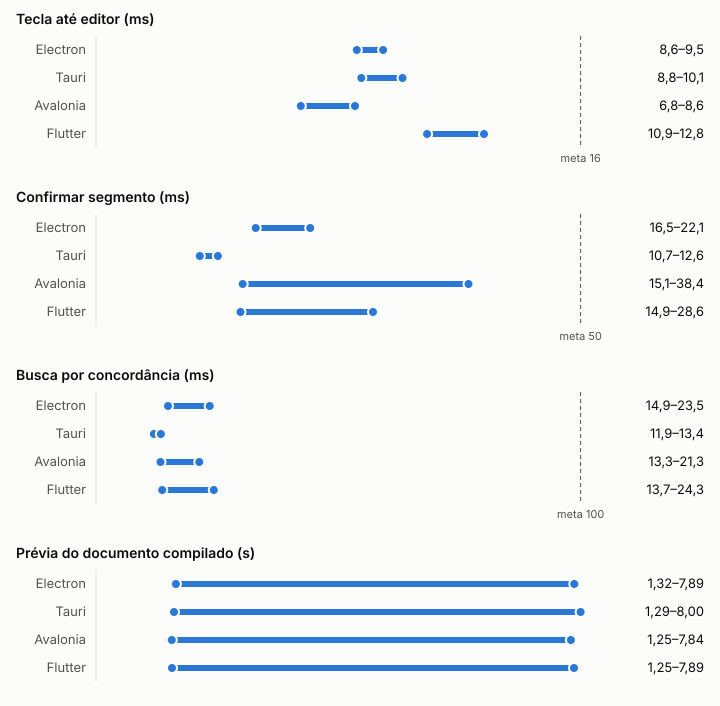
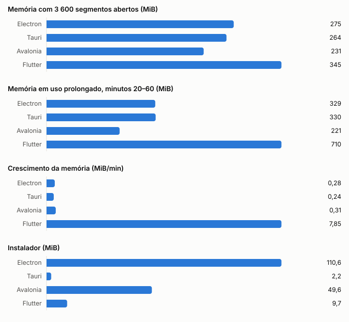

# Qual shell desktop para um editor de tradução? Uma comparação no Windows

Comparamos Electron, Tauri 2, Avalonia e Flutter implementando em cada um o mesmo protótipo de editor de tradução (ferramenta CAT). No Windows, todos atingiram as metas de latência; Electron, Tauri e Avalonia terminaram em empate técnico, e o Flutter ficou atrás, principalmente pelo consumo de memória do editor escolhido.

## Pergunta e hipóteses

Para um editor desktop de documentos estruturados, com trabalho offline, sincronização e prévia ao vivo, qual shell usar?

Não registramos uma hipótese sobre quem venceria: o protocolo formulou perguntas, sem resultado esperado, e fixou antes das medições as metas e os pesos. As afirmações testadas foram:

1. A digitação cabe em um quadro (p95 abaixo de 16 ms) em um computador restrito, e a prévia se atualiza em menos de 50 ms. Acima de 33 ms na digitação, o candidato seria eliminado.
2. As operações do editor cumprem as metas: confirmar segmento (< 50 ms), mesclar e dividir (< 100 ms), buscar por concordância na memória de tradução (< 100 ms), abrir um documento longo (< 2 s) e rolar com menos de 5% de quadros perdidos.
3. A memória não cresce continuamente em uma hora de uso.

## Metodologia

**Candidatos.**

| Shell | Versão | Editor do segmento |
| --- | --- | --- |
| Electron | 44.4.5 | ProseMirror |
| Tauri 2 | WebView2 158.0.4370.33 | ProseMirror (mesmo front-end do Electron) |
| Avalonia | 12.2.0 (.NET 10) | controle próprio, escrito para o estudo |
| Flutter | 3.50.1 | Fleather 1.28.0 |

### Como o protótipo foi desenhado para ser comparável

A ideia foi manter igual tudo o que não é o shell, para que as diferenças venham dele e do editor de texto.

- **Uma especificação única**, aprovada antes da implementação: mesma tela (lista de segmentos à esquerda, prévia à direita, janela de 1440 × 900, sem animações), mesmos atalhos e mesmo comportamento das tags, que funcionam como um único caractere e pedem confirmação antes de serem apagadas.
- **Os mesmos recursos:** importação de DOCX, XLSX e PPTX; lista virtualizada; edição só no segmento ativo; prévia a cada tecla; banco SQLite com fila de sincronização; mesclar e dividir; busca em memória de tradução.
- **Um núcleo comum em Rust** faz importação, separação em frases, banco, busca e exportação. Electron, Avalonia e Flutter o usam como processo separado; o Tauri o chama dentro do próprio processo, o que lhe poupa essa comunicação. O tempo gasto no núcleo é registrado à parte.
- **Os mesmos testes funcionais** por teclado, cobrindo rolagem, tags, prévia, gravação, mesclar e dividir, busca por concordância e prévia do documento compilado, passam nos quatro.
- **O mesmo uso:** um [programa externo](../harness/driver/src/main.rs) executa um [roteiro único](../spec/roteiros/medicao.json) (a [rolagem](../spec/roteiros/rolagem.json) e o [uso prolongado](../spec/roteiros/uso_prolongado.json) têm roteiros próprios), enviando teclas pelo sistema operacional, com os mesmos documentos e a mesma memória de tradução. Os quatro são medidos em versão de produção.
- **As mesmas condições:** mesmo computador, ordem sorteada a cada repetição, mesmos limites de núcleos e memória no perfil restrito, mesma preferência de GPU e o mesmo script e compressão de instalador.

O que não é igual também define a leitura dos resultados. Electron e Tauri compartilham o front-end com o editor [ProseMirror](https://prosemirror.net/docs/guide/) ([código no estudo](../apps/electron/src/renderer/editor.ts)); o Avalonia usa um [editor escrito para o estudo](../apps/avalonia/SegmentEditor.cs); o Flutter usa o [Fleather](https://pub.dev/packages/fleather) ([código no estudo](../apps/flutter/lib/editor.dart)). Cada framework informa o quadro desenhado por um mecanismo próprio. No Avalonia, o modo de composição gráfica foi trocado para que a rolagem pudesse ser medida.

### O que cada comparação mede

| Comparação | O que é medido | O que indica ao usuário |
| --- | --- | --- |
| Tecla até editor | Do envio da tecla ao quadro seguinte com o texto alterado no editor | Se a digitação responde sem atraso |
| Prévia aproximada\* | Do envio da tecla ao quadro seguinte com a prévia alterada | Se a prévia acompanha a digitação |
| Prévia do documento compilado | Do pedido até a página do documento exportado aparecer, incluindo exportação e conversão pelo LibreOffice | Quanto se espera para conferir o documento |
| Confirmar segmento | Do atalho até o segmento gravado e o próximo em foco | A fluidez para passar de um segmento ao outro |
| Mesclar e dividir | Do atalho até a lista e a prévia atualizadas | O custo de corrigir a segmentação |
| Busca na memória | Do Enter até os resultados da busca por concordância (texto contido) aparecerem | A rapidez para consultar traduções anteriores |
| Abrir documento longo | Do início da abertura até ser possível editar, sem contar a partida do app | A espera para começar a trabalhar |
| Quadros perdidos na rolagem | Quadros que faltam, em relação a 60 por segundo, durante a rolagem contínua pela roda do mouse | Se a lista mantém em média ao menos 60 quadros por segundo |
| Memória com documento aberto | Soma da memória privada de todos os processos logo após abrir 3 600 segmentos | O peso do app no começo do uso |
| Memória em uso prolongado | A mesma soma, em amostras a cada minuto durante 60 minutos de uso repetido, trocando entre três documentos | O peso do app ao longo do trabalho |
| Crescimento da memória | Inclinação da memória entre os minutos 20 e 60; é contínuo se passar de 0,5 MiB/min com intervalo de 95% acima de zero | Sinal de vazamento de memória |
| Instalador | Tamanho do arquivo de instalação | O que o usuário precisa baixar |

\* **Prévia aproximada:** blocos de texto estilizados (parágrafo, título, item de lista, linha de tabela, negrito, itálico e link), atualizados a cada tecla. Não reproduz o layout, as fontes, as tabelas completas nem a paginação do documento.

Nas medidas de tempo, o **p95** é o valor que 95% das ocorrências não ultrapassam, calculado separadamente para cada documento.

**Ambiente.** Um notebook com Intel Core Ultra 7 255HX, 31 GB, GPU Intel integrada e NVIDIA RTX 5070 Laptop, tela de 240 Hz e Windows 11. O perfil principal, **restrito**, usa 4 núcleos, 8 GB e a GPU integrada. Um perfil sem limites teve cobertura menor.

### Arquivos utilizados

| Arquivo | Origem | Segmentos | Tamanho (MiB) |
| --- | --- | --- | --- |
| Pequeno (`.docx`) | sintético | 120 | 0,04 |
| Médio (`.docx`) | sintético | 1 200 | 0,07 |
| Longo (`.docx`) | sintético | 3 600 | 0,12 |
| Pior caso (`.docx`) | sintético, com muitas tags | 10 000 | 0,32 |
| Layout complexo (`.docx`) | CMS-10569, governo dos EUA | 329 | 0,07 |
| Texto longo (`.docx`) | *Moby Dick*, domínio público, convertido de texto digitalizado | 5 424 | 0,28 |
| Apresentação (`.pptx`, 596 slides) | privada, conteúdo não publicado | 1 718 | 476,09 |
| Memória de tradução (1 750 arquivos `.tmx`) | DGT-TM, Comissão Europeia | 51 769 pares | 558,92 |

Todos os tamanhos e medidas de memória do artigo usam 1 MiB = 1 048 576 bytes. Os sintéticos são criados por [`gen_corpus.py`](../corpus/gen_corpus.py), e os reais são preparados por [`converter_real.py`](../corpus/converter_real.py). O uso prolongado alterna entre os documentos pequeno, médio e longo.

**Medição.** Um programa externo envia as teclas pelo sistema operacional, e o app registra o quadro seguinte à mudança. Foram dez repetições em ordem sorteada, com a primeira descartada. Uma meta só conta como atingida se o limite superior do intervalo de 95% do p95 fica abaixo dela. A memória é a soma de todos os processos; a rolagem é medida com PresentMon. O uso prolongado é um roteiro de 60 minutos, executado uma vez por candidato; o do Flutter foi repetido depois de um intervalo sem resposta, e vale a repetição.

## Resultados

### Comparação lado a lado

Perfil restrito. Cada faixa vai do documento com o menor valor ao documento com o maior; todas as medidas desta tabela são **↓ quanto menor, melhor**; só as notas, mais abaixo, são **↑ quanto maior, melhor**.

| Comparação (meta) | Melhor | Electron | Tauri | Avalonia | Flutter |
| --- | --- | --- | --- | --- | --- |
| Tecla até editor, p95, ms (< 16) | ↓ menor | 8,6–9,5 | 8,8–10,1 | 6,8–8,6 | 10,9–12,8 |
| Prévia aproximada\*, tecla até atualizar, p95, ms (< 50) | ↓ menor | 8,6–9,5 | 8,8–10,1 | 6,8–8,6 | 10,9–12,8 |
| Prévia do documento compilado, p95, s (sem meta) | ↓ menor | 1,32–7,89 | 1,29–8,00 | 1,25–7,84 | 1,25–7,89 |
| Confirmar segmento, p95, ms (< 50) | ↓ menor | 16,5–22,1 | 10,7–12,6 | 15,1–38,4 | 14,9–28,6 |
| Mesclar e dividir, pior p95, ms (< 100) | ↓ menor | 34,4 | 23,1 | 32,3 | 33,3 |
| Busca na memória por concordância, p95, ms (< 100) | ↓ menor | 14,9–23,5 | 11,9–13,4 | 13,3–21,3 | 13,7–24,3 |
| Abrir 10 000 segmentos, mediana, ms (< 2 000) | ↓ menor | 656 | 483 | 1 117 | 595 |
| Quadros perdidos na rolagem contínua (< 5%)† | ↓ menor | 0% | 0% | 0% | 0% |
| Memória com 3 600 segmentos abertos, MiB | ↓ menor | 275 | 264 | 231 | 345 |
| Memória em uso prolongado, mediana dos minutos 20–60, MiB | ↓ menor | 329 | 330 | 221 | 710‡ |
| Crescimento da memória, MiB/min | ↓ menor | 0,28 | 0,24 | 0,31 | 7,85‡ |
| Instalador, MiB | ↓ menor | 110,6 | 2,2 | 49,6 | 9,7 |

† Sem o documento pequeno: nele a lista chega ao fim durante a rolagem, e o valor (até cerca de 11%) não mede desempenho. Essa exclusão foi decidida depois de conhecidos os resultados.

‡ Resultado oficial, com a biblioteca Fleather 1.28.0 como publicada. Com três correções feitas pelo estudo, testadas depois, o Flutter fica em **382 MiB** e cresce **0,01 MiB/min**, sem crescimento contínuo, mas segue com a maior memória dos quatro. A versão corrigida não entra na nota oficial ([correções](../harness/patches/fleather-1.28.0.patch); detalhes em Memória e tamanho).

\* **Prévia aproximada:** blocos de texto estilizados (parágrafo, título, item de lista, linha de tabela, negrito, itálico e link), atualizados a cada tecla. Não reproduz o layout, as fontes, as tabelas completas nem a paginação do documento.

#### Gráficos

Em todos os gráficos, **↓ quanto menor, melhor**. Nos tempos, cada barra vai do documento com o menor p95 ao documento com o maior, e a linha tracejada marca a meta.

As 308 combinações de latência com meta (app, perfil, documento, medida e passo) atingiram o alvo; rolagem e memória são relatadas à parte. Os apps registram o editor e a prévia aproximada com a mesma marcação de quadro: o número da prévia não acrescenta informação, embora entre na nota de desempenho. A rolagem é comparada a 60 Hz e não distingue as taxas acima disso.

A prévia do documento compilado é feita sob demanda: o núcleo exporta o arquivo, o LibreOffice converte a página em imagem e o app a exibe; o tempo vai do pedido até a página aparecer. O maior valor é o da apresentação PPTX. Os quatro ficam praticamente iguais porque a conversão, comum a todos, domina o tempo, e por isso a medida não entra na nota. A aparência pode diferir da que o Word ou o PowerPoint produzem.

Quatro rodadas refeitas usaram uma pequena animação controlada na tela; as demais rodaram sem ela, e não se sabe o que redesenhava a tela. Nas versões dessas quatro rodadas feitas com a tela parada, o p95 de digitação e confirmação em Electron, Tauri e Avalonia foi cerca de 5 a 12 ms maior, sem explicação conhecida: das 112 combinações, 107 atingem a meta, 4 ficam no limite e 1 não atinge.

### Memória e tamanho

O instalador do Tauri não inclui o WebView2, presumido no sistema.

Só o Flutter mostrou crescimento contínuo. Parte dele vem de três pontos do Fleather 1.28.0 que podem reter editores já descartados. Em um teste adicional, feito depois do resultado oficial e com as três correções, a mediana caiu para 382 MiB e o crescimento para 0,01 MiB/min. As latências não foram medidas com a correção, que não passou por revisão dos autores da biblioteca.

### Pontuação parcial (1 a 5)

**↑ Quanto maior a nota, melhor**, em todos os critérios e no total.

| Critério (peso), ↑ maior | Electron | Tauri | Avalonia | Flutter |
| --- | --- | --- | --- | --- |
| Desempenho (22%) | 4,75 | 4,75 | 4,86 | 4,71 |
| Memória (17%) | 4 | 4 | 5 | 1 |
| Ecossistema de formatos (11%) | 4 | 3 | 4 | 3 |
| Instalador (5%) | 1 | 5 | 1 | 1 |
| **Total** | **4,03** | **4,19** | **4,38** | **2,89** |

O total usa 55 dos 100 pontos de peso. Ficaram fora a consistência entre sistemas (28%), não medida, e o esforço de implementação (17%), porque as horas não foram registradas. A nota de ecossistema é um julgamento sobre as bibliotecas disponíveis para DOCX, XLSX e XLIFF. As regras de conversão em notas foram registradas antes; as escolhas que elas deixavam em aberto sobre como juntar as medições foram feitas depois de conhecidos os resultados.

**Electron, Tauri e Avalonia estão em empate técnico** (menos de 10% de diferença). Em 60 variações do cálculo, o Tauri liderou em 36 e o Avalonia em 24; o Electron ficou a menos de 10% do primeiro em 45, e os outros dois em todas. O desempate registrado usa o critério de maior peso, a consistência entre sistemas, que não foi medida. Com o Flutter corrigido, a nota dele iria a 3,81.

## O que se pode concluir

- No Windows, a latência não separa os candidatos: todos cumprem as metas. A prévia do documento compilado também não.
- O Avalonia usou menos memória, mas com um editor escrito para o estudo.
- O Tauri teve de longe o menor instalador.
- O resultado do Flutter foi obtido com o Fleather 1.28.0 e não deve ser generalizado para o framework.
- Não há vencedor. A escolha entre os três primeiros depende do peso que cada projeto dá a memória, tamanho, bibliotecas e experiência da equipe.

## Limitações

Um único computador e sistema; uma execução de uso prolongado por candidato, com um documento aberto por vez; registro do quadro feito dentro do app, com método diferente em cada framework e sem incluir a varredura da tela; busca testada com 51 769 pares, não os 100 000 previstos, e só por concordância: a busca por similaridade, também prevista, não foi medida. As primeiras rodadas não tinham a proteção que impede teclas de irem para outra janela. A rolagem do perfil sem limites não tem execução de comparação para o efeito da tela. O editor pago da Avalonia (RichTextEditor) não foi avaliado, a entrada por IME de chinês, japonês e coreano ficou fora, e os testes do Flutter corrigido não cobrem mouse nem área de transferência. O protocolo recebeu emendas durante o estudo, inclusive uma regra para invalidar rodadas criada depois da primeira leitura dos dados, baseada na própria medida de digitação, e que levou a refazer quatro rodadas. Electron e Tauri compartilham o front-end. Implementação, medição, análise e redação foram feitas com um agente de IA, com mediação do autor.

Protocolo, emendas, código e dados brutos acompanham o repositório do estudo (`PREREGISTRO.md`, `harness/`, `results/`).
