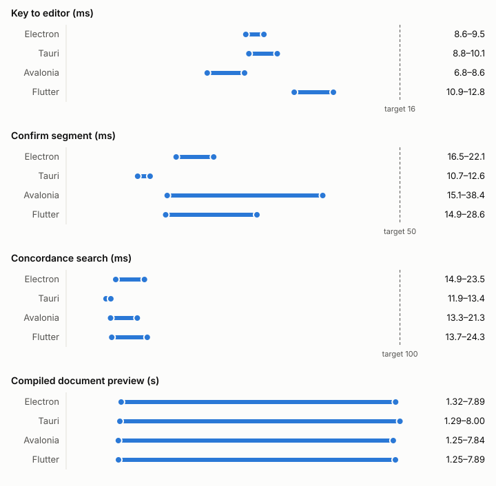
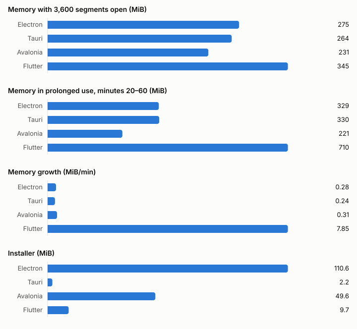

# Which desktop shell for a translation editor? A comparison on Windows

We compared Electron, Tauri 2, Avalonia and Flutter by building the same translation-editor prototype (a computer-assisted translation, or CAT, tool) in each of them. On Windows, all four met the latency targets; Electron, Tauri and Avalonia ended in a technical tie, and Flutter came last, mainly because of the memory use of the editor chosen for it.

## Question and hypotheses

Which shell should be used for a desktop editor of structured documents, with offline support, synchronisation and live preview?

We registered no hypothesis about which candidate would win: the protocol posed questions without expected answers, and fixed the targets and weights before any measurement. The claims tested were:

1. Typing fits within one frame (p95 below 16 ms) on a resource-restricted computer, and the preview updates in under 50 ms. A candidate above 33 ms for typing would be eliminated.
2. Editor operations meet their targets: confirming a segment (< 50 ms), merging and splitting (< 100 ms), concordance search in the translation memory (< 100 ms), opening a long document (< 2 s) and scrolling with fewer than 5% dropped frames.
3. Memory does not grow continuously over one hour of use.

## Methodology

**Candidates.**

| Shell | Version | Segment editor |
| --- | --- | --- |
| Electron | 44.4.5 | ProseMirror |
| Tauri 2 | WebView2 158.0.4370.33 | ProseMirror (same front end as Electron) |
| Avalonia | 12.2.0 (.NET 10) | custom control, written for the study |
| Flutter | 3.50.1 | Fleather 1.28.0 |

### How the prototype was designed to be comparable

The idea was to keep everything except the shell the same, so that differences would come from the shell and the text editor.

- **A single specification**, approved before implementation: same screen (segment list on the left, preview on the right, 1440 × 900 window, no animations), same shortcuts and same tag behaviour (a tag acts as a single character, and deleting it asks for confirmation).
- **The same features:** DOCX, XLSX and PPTX import; virtualised list; editing only in the active segment; preview on every keystroke; SQLite database with a synchronisation queue; merge and split; translation memory search.
- **A shared Rust core** handles import, sentence segmentation, database, search and export. Electron, Avalonia and Flutter run it as a separate process; Tauri calls it inside its own process, which avoids that inter-process communication. Time spent in the core is recorded separately.
- **The same functional tests**, driven by keyboard and covering scrolling, tags, preview, saving, merge and split, concordance search and compiled document preview, pass on all four.
- **The same workload:** an [external program](../harness/driver/src/main.rs) runs a [single script](../spec/roteiros/medicao.json) ([scrolling](../spec/roteiros/rolagem.json) and [prolonged use](../spec/roteiros/uso_prolongado.json) have their own scripts), sending keystrokes through the operating system, with the same documents and the same translation memory. All four are measured as production builds.
- **The same conditions:** same computer, random order on every repetition, same core and memory limits in the restricted profile, same GPU preference, and the same installer script and compression.

What differs also shapes how the results should be read. Electron and Tauri share the front end with the [ProseMirror](https://prosemirror.net/docs/guide/) editor ([code in the study](../apps/electron/src/renderer/editor.ts)); Avalonia uses an [editor written for the study](../apps/avalonia/SegmentEditor.cs); Flutter uses [Fleather](https://pub.dev/packages/fleather) ([code in the study](../apps/flutter/lib/editor.dart)). Each framework reports the drawn frame through its own mechanism. In Avalonia, the graphics composition mode was changed so that scrolling could be measured.

### What each comparison measures

| Comparison | What is measured | What it tells the user |
| --- | --- | --- |
| Key to editor | From the keystroke being sent to the next frame showing the changed text in the editor | Whether typing responds without delay |
| Approximate preview\* | From the keystroke being sent to the next frame showing the changed preview | Whether the preview keeps up with typing |
| Compiled document preview | From the request until the page of the exported document appears, including export and conversion by LibreOffice | How long it takes to check the document |
| Confirm segment | From the shortcut until the segment is saved and the next one has focus | How smoothly one moves from segment to segment |
| Merge and split | From the shortcut until the list and preview are updated | The cost of fixing segmentation |
| Memory search | From Enter until the results of a concordance (substring) search appear | How quickly past translations can be consulted |
| Open long document | From the start of opening until editing is possible, excluding app start-up | The wait before work can begin |
| Dropped frames while scrolling | Frames missing, relative to 60 per second, during continuous mouse-wheel scrolling | Whether the list sustains at least 60 frames per second on average |
| Memory with a document open | Sum of the private memory of all processes right after opening 3,600 segments | How heavy the app is at the start of use |
| Memory in prolonged use | The same sum, sampled every minute during 60 minutes of repeated use, switching between three documents | How heavy the app is over a working session |
| Memory growth | Slope of memory between minutes 20 and 60; counted as continuous if above 0.5 MiB/min with a 95% interval above zero | A sign of a memory leak |
| Installer | Size of the installation file | What the user has to download |

\* **Approximate preview:** styled text blocks (paragraph, heading, list item, table row, bold, italic and link), updated on every keystroke. It does not reproduce the document's layout, fonts, full tables or pagination.

In the timing measurements, **p95** is the value that 95% of occurrences do not exceed, calculated separately for each document.

**Environment.** One laptop with an Intel Core Ultra 7 255HX, 31 GB, Intel integrated GPU and NVIDIA RTX 5070 Laptop, 240 Hz screen and Windows 11. The main profile, **restricted**, uses 4 cores, 8 GB and the integrated GPU. An unrestricted profile had narrower coverage.

### Files used

| File | Source | Segments | Size (MiB) |
| --- | --- | --- | --- |
| Small (`.docx`) | synthetic | 120 | 0.04 |
| Medium (`.docx`) | synthetic | 1,200 | 0.07 |
| Long (`.docx`) | synthetic | 3,600 | 0.12 |
| Worst case (`.docx`) | synthetic, tag-heavy | 10,000 | 0.32 |
| Complex layout (`.docx`) | CMS-10569, US government | 329 | 0.07 |
| Long text (`.docx`) | *Moby Dick*, public domain, converted from scanned text | 5,424 | 0.28 |
| Presentation (`.pptx`, 596 slides) | private, content not published | 1,718 | 476.09 |
| Translation memory (1,750 `.tmx` files) | DGT-TM, European Commission | 51,769 pairs | 558.92 |

All sizes and memory figures in this article use 1 MiB = 1,048,576 bytes. The synthetic files are created by [`gen_corpus.py`](../corpus/gen_corpus.py), and the real ones are prepared by [`converter_real.py`](../corpus/converter_real.py). Prolonged use alternates between the small, medium and long documents.

**Measurement.** An external program sends keystrokes through the operating system, and the app records the frame that follows the change. There were ten repetitions in random order, the first one discarded. A target only counts as met if the upper bound of the 95% interval of the p95 is below it. Memory is the sum over all processes; scrolling is measured with PresentMon. Prolonged use is a 60-minute script, run once per candidate; Flutter's run was repeated after an unresponsive gap, and the repeat is the one reported.

## Results

### Side-by-side comparison

Restricted profile. Each range goes from the document with the lowest value to the document with the highest. Every measure in this table is **↓ lower is better**; only the scores further down are **↑ higher is better**.

| Comparison (target) | Better | Electron | Tauri | Avalonia | Flutter |
| --- | --- | --- | --- | --- | --- |
| Key to editor, p95, ms (< 16) | ↓ lower | 8.6–9.5 | 8.8–10.1 | 6.8–8.6 | 10.9–12.8 |
| Approximate preview\*, key to update, p95, ms (< 50) | ↓ lower | 8.6–9.5 | 8.8–10.1 | 6.8–8.6 | 10.9–12.8 |
| Compiled document preview, p95, s (no target) | ↓ lower | 1.32–7.89 | 1.29–8.00 | 1.25–7.84 | 1.25–7.89 |
| Confirm segment, p95, ms (< 50) | ↓ lower | 16.5–22.1 | 10.7–12.6 | 15.1–38.4 | 14.9–28.6 |
| Merge and split, worst p95, ms (< 100) | ↓ lower | 34.4 | 23.1 | 32.3 | 33.3 |
| Concordance search in the memory, p95, ms (< 100) | ↓ lower | 14.9–23.5 | 11.9–13.4 | 13.3–21.3 | 13.7–24.3 |
| Open 10,000 segments, median, ms (< 2,000) | ↓ lower | 656 | 483 | 1,117 | 595 |
| Dropped frames in continuous scrolling (< 5%)† | ↓ lower | 0% | 0% | 0% | 0% |
| Memory with 3,600 segments open, MiB | ↓ lower | 275 | 264 | 231 | 345 |
| Memory in prolonged use, median of minutes 20–60, MiB | ↓ lower | 329 | 330 | 221 | 710‡ |
| Memory growth, MiB/min | ↓ lower | 0.28 | 0.24 | 0.31 | 7.85‡ |
| Installer, MiB | ↓ lower | 110.6 | 2.2 | 49.6 | 9.7 |

† Excluding the small document: its list reaches the end while scrolling, so the value (up to about 11%) does not measure performance. This exclusion was decided after the results were known.

‡ Official result, with the Fleather 1.28.0 library as published. With three fixes made by the study and tested afterwards, Flutter stays at **382 MiB** and grows by **0.01 MiB/min**, with no continuous growth, but still uses the most memory of the four. The fixed build does not count towards the official score ([fixes](../harness/patches/fleather-1.28.0.patch); details under Memory and size).

\* **Approximate preview:** styled text blocks (paragraph, heading, list item, table row, bold, italic and link), updated on every keystroke. It does not reproduce the document's layout, fonts, full tables or pagination.

#### Charts

In all charts, **↓ lower is better**. In the timing chart, each bar goes from the document with the lowest p95 to the document with the highest, and the dashed line marks the target.

All 308 latency combinations that have a target (app, profile, document, measure and step) met it; scrolling and memory are reported separately. The apps timestamp the editor and the approximate preview with the same frame callback, so the preview figure adds no independent information, although it counts towards the performance score. Scrolling is compared against 60 Hz and does not distinguish rates above that.

The compiled document preview is produced on demand: the core exports the file, LibreOffice converts the page into an image and the app displays it; the time runs from the request until the page appears. The highest value belongs to the PPTX presentation. The four are practically equal because the conversion, common to all of them, dominates the time, so this measure is not scored. The appearance may differ from what Word or PowerPoint produce.

Four re-run rounds used a small, controlled on-screen animation; the others ran without it, and what was redrawing the screen then is unknown. In the versions of those four rounds run with a static screen, the p95 of typing and confirmation in Electron, Tauri and Avalonia was about 5 to 12 ms higher, for reasons unknown: of the 112 combinations, 107 meet the target, 4 are borderline and 1 misses it.

### Memory and size

The Tauri installer does not include WebView2, which is assumed to be present on the system.

Only Flutter showed continuous growth. Part of it comes from three places in Fleather 1.28.0 that can retain editors that have already been discarded. In an additional test, run after the official result and with all three fixes, the median fell to 382 MiB and growth to 0.01 MiB/min. Latencies were not measured with the fix, which has not been reviewed by the library's authors.

### Partial score (1 to 5)

**↑ Higher is better**, for every criterion and for the total.

| Criterion (weight), ↑ higher | Electron | Tauri | Avalonia | Flutter |
| --- | --- | --- | --- | --- |
| Performance (22%) | 4.75 | 4.75 | 4.86 | 4.71 |
| Memory (17%) | 4 | 4 | 5 | 1 |
| Format ecosystem (11%) | 4 | 3 | 4 | 3 |
| Installer (5%) | 1 | 5 | 1 | 1 |
| **Total** | **4.03** | **4.19** | **4.38** | **2.89** |

The total uses 55 of the 100 weight points. Consistency across operating systems (28%), which was not measured, and implementation effort (17%), whose hours were not recorded, are left out. The ecosystem score is a judgement about the libraries available for DOCX, XLSX and XLIFF. The rules converting measurements into scores were registered beforehand; the choices they left open on how to aggregate measurements were made after the results were known.

**Electron, Tauri and Avalonia are in a technical tie** (less than 10% apart). Across 60 variations of the calculation, Tauri led in 36 and Avalonia in 24; Electron stayed within 10% of the leader in 45, and the other two in all of them. The registered tie-break uses the heaviest criterion, cross-system consistency, which has not been measured. With the fixed Fleather, Flutter's score would be 3.81.

## What can be concluded

- On Windows, latency does not separate the candidates: all meet the targets. Nor does the compiled document preview.
- Avalonia used the least memory, but with an editor written for the study.
- Tauri had by far the smallest installer.
- Flutter's result was obtained with Fleather 1.28.0 and should not be generalised to the framework.
- There is no winner. The choice among the top three depends on how much weight each project gives to memory, size, libraries and team experience.

## Limitations

A single computer and operating system; one prolonged-use run per candidate, with one document open at a time; frame timestamping done inside the app, with a different method in each framework and not including display scan-out; search tested with 51,769 pairs, not the planned 100,000, and only in concordance mode: similarity search, also planned, was not measured. The earliest rounds lacked the guard that stops keystrokes from reaching another window. Scrolling in the unrestricted profile has no comparison run for the screen effect. Avalonia's paid editor (RichTextEditor) was not evaluated, Chinese, Japanese and Korean IME input was out of scope, and the tests of the fixed Flutter build do not cover the mouse or the clipboard. The protocol was amended during the study, including a rule for invalidating runs that was created after the first reading of the data, based on the typing measure itself, which led to four rounds being run again. Electron and Tauri share the front end. Implementation, measurement, analysis and writing were done with an AI agent, mediated by the author.

The protocol, amendments, code and raw data are in the study repository (`PREREGISTRO.md`, `harness/`, `results/`). The protocol, specification and code comments are in Portuguese.
